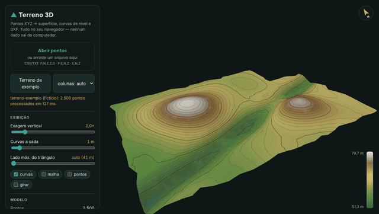

# Terreno 3D

[](https://github.com/maessa-oliveira/terreno-3d/actions/workflows/ci.yml)
[](https://maessa-oliveira.github.io/terreno-3d/)
[](LICENSE)

**Visualizador 3D de levantamento topográfico, direto no navegador.** Carregue um arquivo de pontos
(P,N,E,Z,D — o formato da coletora e do Civil 3D) e veja o terreno em 3D, com triangulação (TIN),
curvas de nível mestras e intermediárias, estatísticas e exportação das curvas em **DXF**.

👉 **[Abrir a demonstração](https://maessa-oliveira.github.io/terreno-3d/)** — já abre com um terreno fictício.



> 🇬🇧 *Browser-based 3D viewer for land-survey point clouds: Delaunay TIN, contour lines, stats and
> DXF export. No install, no upload — your data never leaves your computer.*

## Recursos

- Lê CSV/TXT com `;`, `,`, tab ou espaço e **vírgula decimal**; detecta a ordem das colunas (PNEZD, PENZ, ENZ).
- Triangulação de Delaunay com **lado máximo** automático (não cria "pontes" em bordas côncavas).
- Curvas de nível com intervalo ajustável; **mestra a cada 5** intervalos.
- Exagero vertical, malha, pontos, rotação automática, rampa hipsométrica e bússola.
- Estatísticas: cotas, desnível, área plana triangulada e volume acima da cota mínima.
- Exporta **curvas em DXF** (POLYLINE com elevação = cota; layers `CURVA_MESTRA` / `CURVA_INTERMEDIARIA`)
  — abre no AutoCAD, Civil 3D, QGIS.
- **Privacidade**: tudo roda no navegador; o arquivo não é enviado para servidor nenhum.

## Como funciona

```
pontos (texto) ─► lerPontos ─► triangular (Delaunator) ─► curvasDeNivel ─► unirSegmentos ─► DXF
                                      │                         │
                                      └──────► three.js (malha colorida + curvas em 3D)
```

- `src/terreno.js` — todo o cálculo, **sem dependência de navegador** (testado em Node).
- `src/app.js` — interface e renderização 3D com three.js.
- As curvas são obtidas por interpolação linear em cada triângulo e os segmentos são unidos em
  polilinhas contínuas (curvas fechadas nos topos de morro).

## Testes

```bash
npm install
npm test            # testes unitários (node --test): leitura, TIN, curvas, área/volume, DXF
npm run test:e2e    # ponta a ponta no Chromium (Playwright): desktop e celular, upload e download do DXF
```

O GitHub Actions roda as duas suítes a cada commit e publica a página no GitHub Pages.

## Dados

O terreno de exemplo (`exemplos/terreno-exemplo.csv`) é **fictício**, gerado por função matemática.

## Licença

MIT — veja [LICENSE](LICENSE). Bibliotecas de terceiros em `vendor/` mantêm suas licenças
(three.js — MIT, Delaunator — ISC, robust-predicates — Unlicense).

## Autora

**Maessa Oliveira** — agrimensora e projetista, graduanda em Engenharia de Software.
[LinkedIn](https://www.linkedin.com/in/maessa-oliveira/)
